# Guía WebApp

El **WebApp** es donde se coordina, se opera la planta, se administra la cuenta y se contratan servicios a otras cuentas. Los conductores trabajan en la [App móvil](guia_app.md).

Reglas de negocio de cada operación (quién firma, cuándo cambia el dueño del residuo): [Casos por operación](casos_entrada_salida_residuos.md).

## Acceso

La pantalla de inicio pide **usuario o correo** y **clave**. Hay **¿Olvidó su clave?** y **Regístrese ahora** si tu empresa aún no tiene cuenta.

Lo que ves depende de las **operaciones habilitadas** en tu cuenta y de los **permisos** de tu rol.

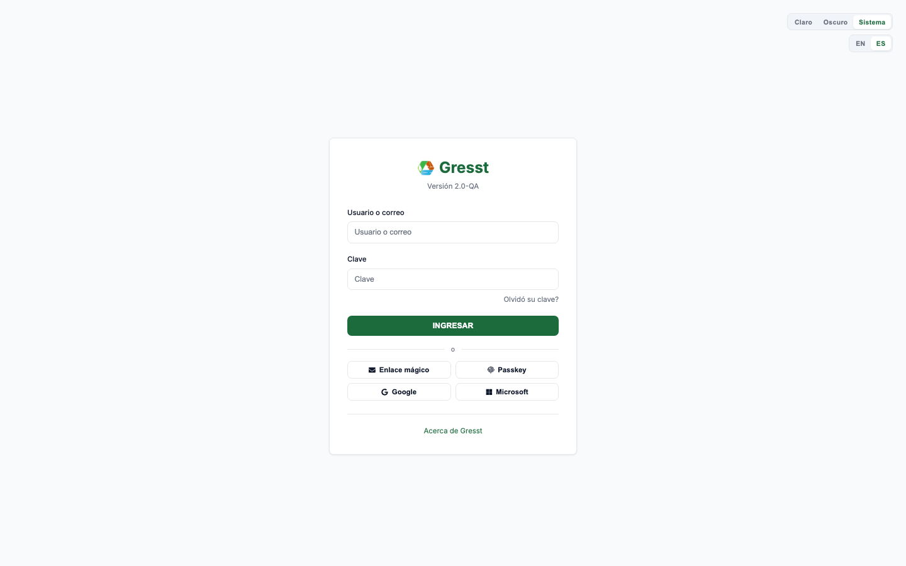

---

## Vistas

Arriba eliges la **vista** con la que trabajas. Cada una tiene su propio menú lateral; la búsqueda (**Ctrl/⌘ + K**) encuentra opciones de todas las vistas.

| Vista | Para qué | Menú |
|-------|----------|------|
| **Administración** | Solo el propietario de la cuenta | Cuenta · Propietario · Usuarios · Roles · Parámetros · Módulos · Integraciones |
| **Configuración** | Catálogos de la cuenta | Empleados · Instalaciones · Vehículos · Residuos · Materiales · Embalajes · Insumos · Operaciones · Tratamientos · Licencias · Terceros |
| **Operaciones** | El trabajo del día | Solicitudes de transporte y de recepción · Generación · Recepción · Recolección · Transporte · Tratamiento · Transferencia · Disposición · … |
| **Control** | Seguimiento de lo operado | Inventario (Residuos · Materiales) · Certificados · Enviar (integraciones) · Tableros · Reportes |
| **Tercerización** | Lo que pasa con tus residuos fuera de tu cuenta | Solicitudes a proveedores · Lo que mis proveedores tienen de mí · Inventario · Certificados · Reportes |

La vista **Tercerización** aparece si tu cuenta tiene habilitada la Transferencia. Si solo tienes acceso a una vista, el selector no se muestra.

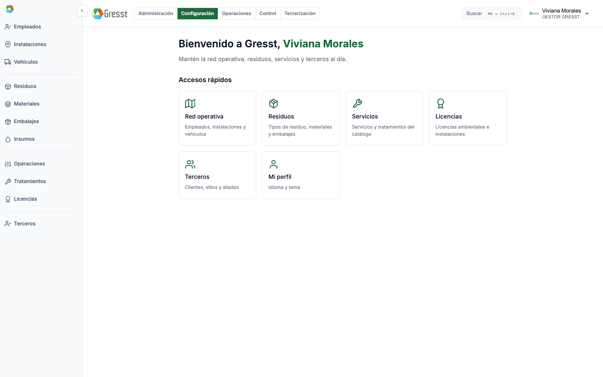

---

## Operaciones

### Transporte y Recepción

Se trabajan igual en **Transporte** y **Recepción**:

1. **Abiertas**: todavía se puede modificar. **Cerradas**: finalizadas, solo lectura.
2. Una ruta (transporte) o un día de recepción **no se parte** entre las dos pestañas. Si una parada o un cliente ya cerró pero la operación sigue abierta, la fila permanece en **Abiertas**.
3. La **fecha** de la fila es la fecha operacional: cuándo se cargó o recibió de verdad; si aún no, la programada; si nunca se programó, la solicitada.
4. **Planear** (cuándo, con qué vehículo o en qué punto) no es obligatorio para todas las cuentas: puedes **registrar la carga o la recepción** directamente y el sistema arma solicitud, orden e inicio por debajo.
5. El trabajo se cierra **por parada** (transporte) o **por cliente en un punto** (recepción): todos los residuos de ese grupo quedan con la misma fecha.
6. En una fecha futura el registro se ve, pero al recibir o cargar el sistema avisa que se guardará **con la fecha de hoy**.

**Transporte (árbol):** ruta → paradas → residuos. Acciones del menú de fila: iniciar, reprogramar, recoger o rechazar, agregar residuo o parada, finalizar la ruta. Hay vista de **mapa** con placa, paradas y captura en panel.

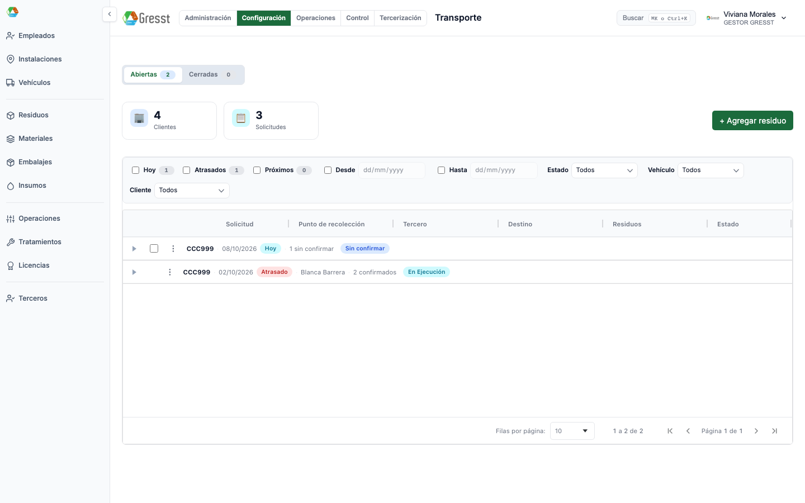

Al expandir una ruta ves sus paradas, y al expandir cada parada, sus residuos:

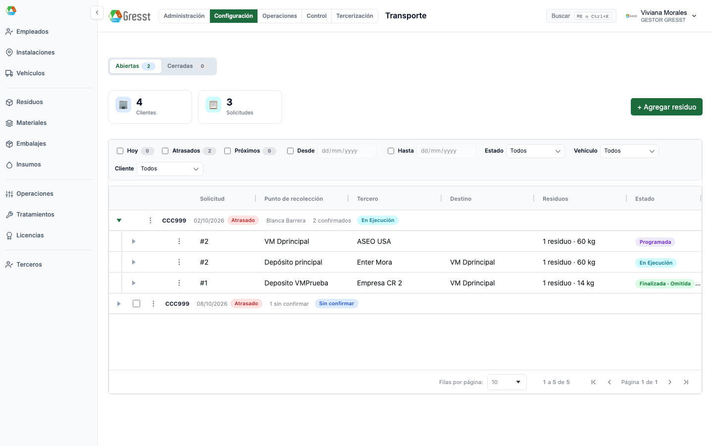

El menú **⋮** de la ruta ofrece **Editar datos de inicio**, **Agregar residuo** y **Ver mapa**:

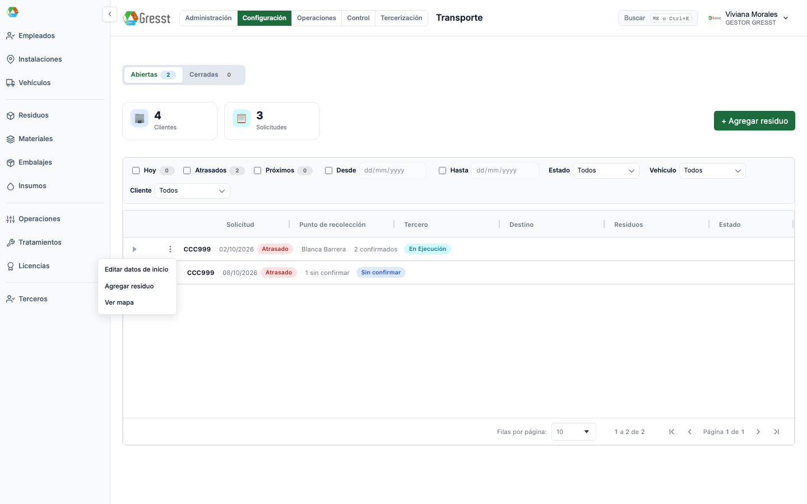

**Recepción (maestro–detalle):** cliente + fecha + punto de recepción; en el detalle, los residuos.

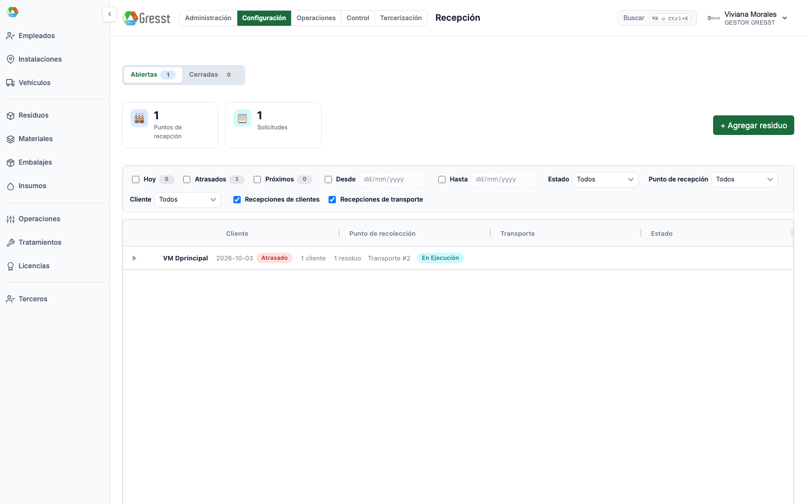

**Agregar residuo** abre el panel de recepción directa: punto de recepción, cliente, transportador, vehículo, fecha, tipo de residuo y cantidades.

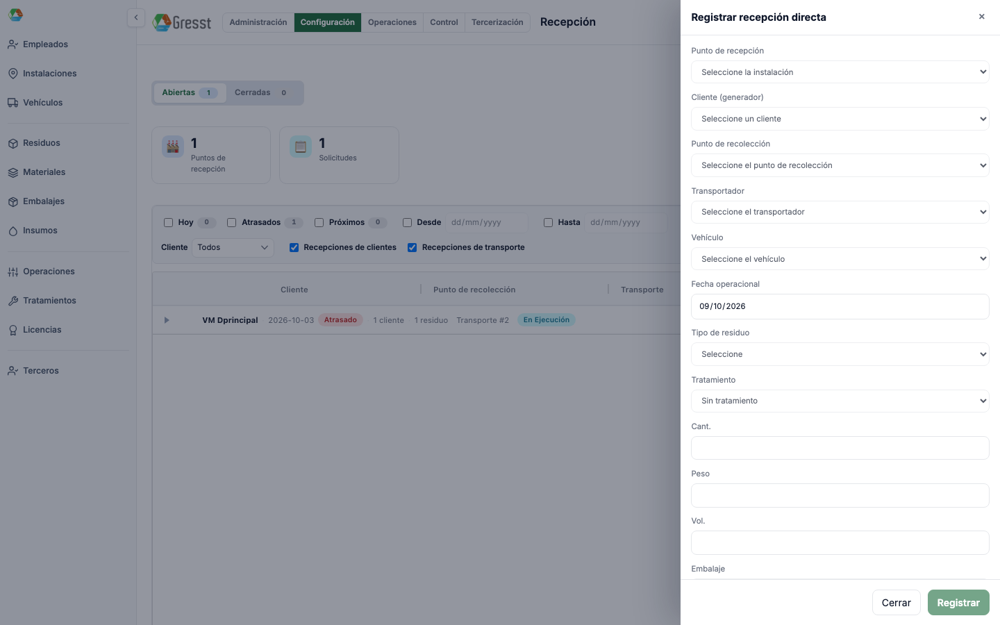

Además, si trabajas con cuentas conectadas:

- **Recepción → Abiertas → Entregas por recibir:** residuos que otra cuenta te transfirió. Los recibes con tu propio tipo de residuo o los rechazas.
- **Transporte → Abiertas → Entregas a transportar:** entregas en las que otra cuenta te eligió como transportador. Registras la recogida y la entrega.

El menú muestra cuántas hay pendientes. Detalle: [Trabajar conectados](guia_conexiones.md#entregas-entre-cuentas-conectadas).

### Otras operaciones

Generación, Procesamiento, Tratamiento, Segregación, Consolidación, Refinación, Digestión, Acopio, Ajuste, Transferencia, Donación, Aprovechamiento, Disposición y Confinamiento tienen cada una su pantalla. Qué hace cada operación y qué le pasa al residuo: [Operaciones y cambios del residuo](operaciones.md).

En cada residuo de la lista, el menú **⋮** tiene la acción principal (**Transferir**, **Disponer**, …): pide lo necesario (destino, fecha, cantidades) y la registra de una vez, sin pasos previos.

**Retorno** todavía no tiene captura: si tu cuenta lo tiene habilitado, verás la pantalla vacía.

### Solicitudes

**Solicitudes de transporte** y **Solicitudes de recepción** son las solicitudes que te piden tus clientes, con pestañas **Abiertas / Cerradas**. El formulario cubre tipo, quiénes participan (quién genera, quién transporta y quién recibe), periodo, recurrencia opcional e ítems de residuo (material, tratamiento, cantidades, embalaje, precios, notas). Si el cliente conectado pidió con un tipo suyo, confirmas a cuál de los tuyos corresponde. Ver [Solicitudes](solicitudes.md).

Cuando registras una solicitud a nombre de un cliente **conectado**, queda esperando su aprobación: ver [Trabajar conectados](guia_conexiones.md#registrar-una-solicitud-a-nombre-de-un-cliente-conectado).

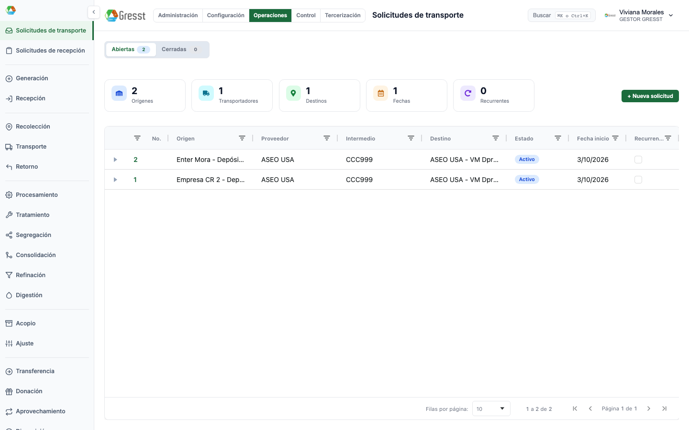

**+ Nueva solicitud** abre el formulario: quién solicita, quién transporta y quién recibe, la fecha y los ítems de residuo. Puedes **Guardar borrador** o **Confirmar**.

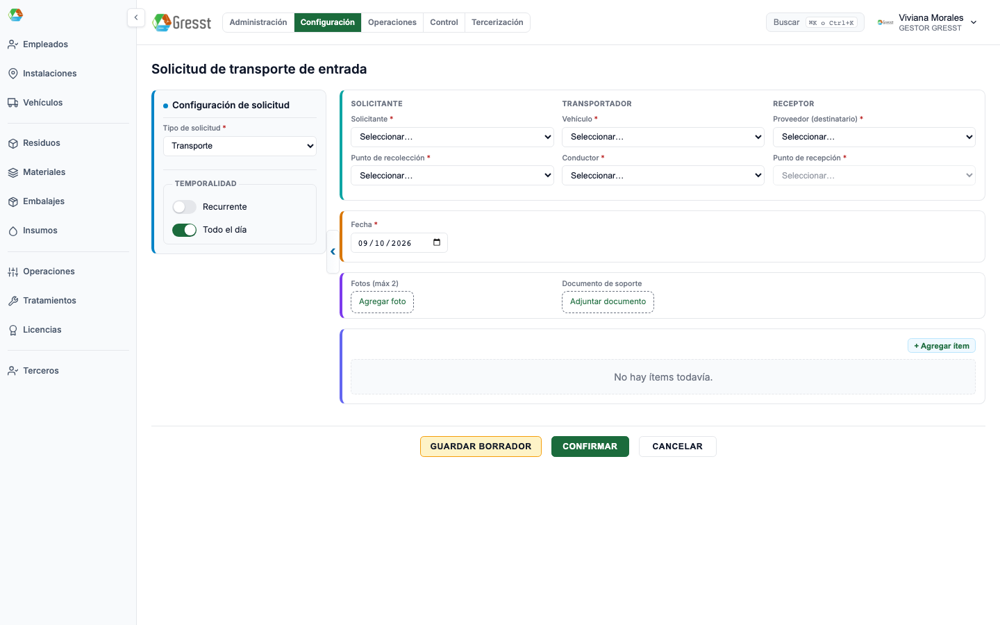

---

## Control

- **Inventario:** **Residuos** y **Materiales** (aprovechables) son dos listas sobre el mismo inventario. Para pasar un tipo de un lado al otro usa el menú de la fila (**Convertir a material / residuo**).
- **Certificados:** una pestaña por tipo de operación; dentro, **Pendientes** y **Emitidos**. Desde Emitidos puedes **Publicar** un certificado para que tu cliente conectado lo vea en su cuenta. Ver [Certificados y documentos](certificados.md).
- **Enviar:** envío a sistemas externos (por ejemplo SIESA), con **Pendientes / Enviados**. Las credenciales se configuran en **Administración → Integraciones**.
- **Tableros** y **Reportes**. En **Reportes → Trazabilidad** ves la historia de cada residuo y, si pasó por cuentas conectadas, su **recorrido entre empresas** ([Trazabilidad](trazabilidad.md)).

  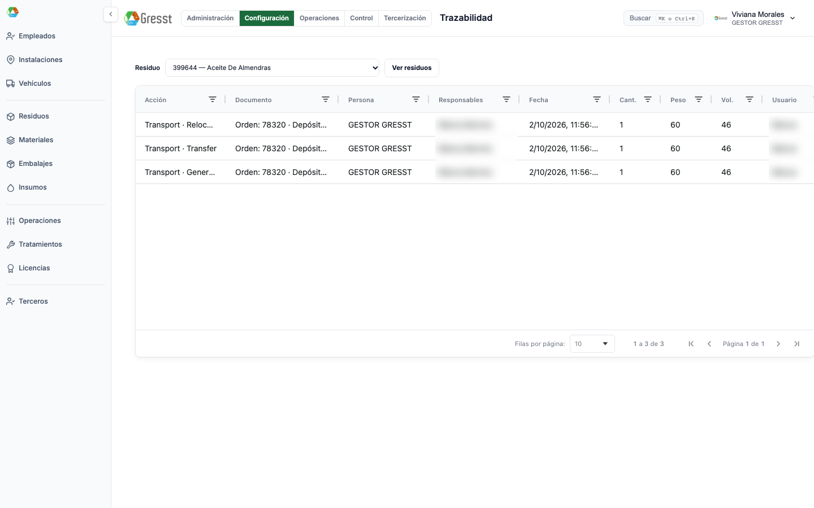

  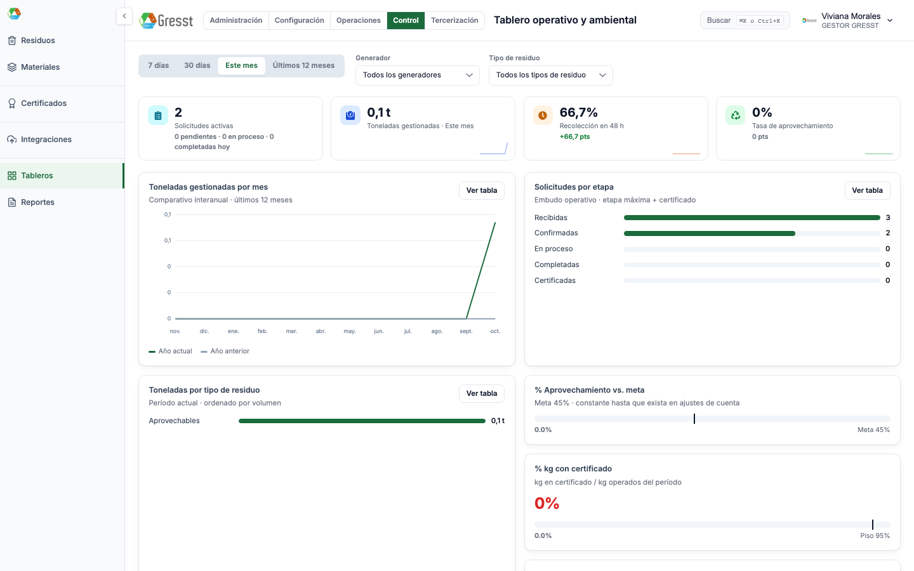

---

## Configuración

Catálogos con búsqueda, grilla y alta/edición.

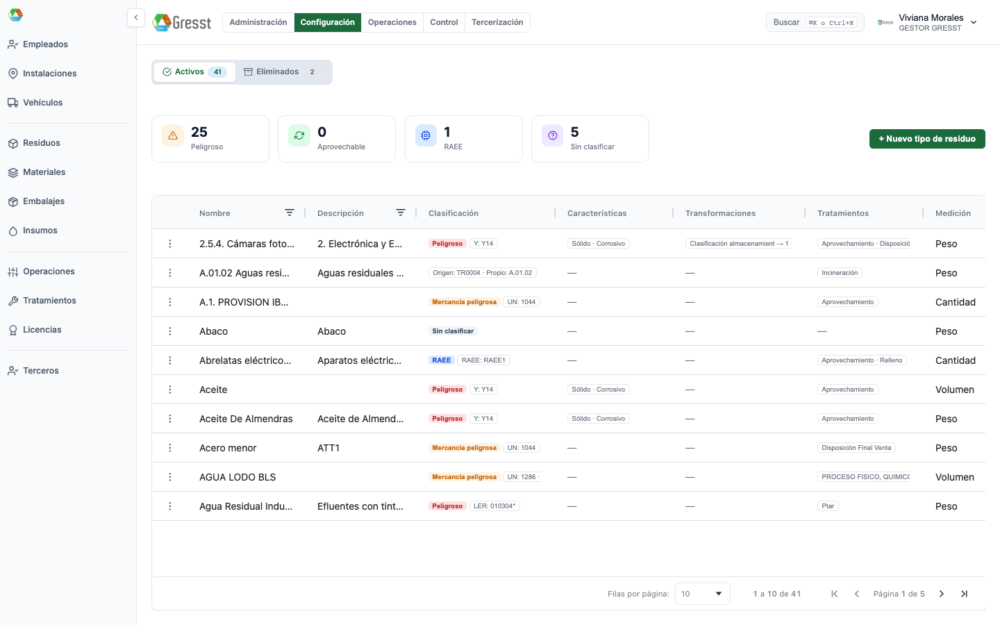

- **Residuos:** cada tipo es residuo o material aprovechable, con sus códigos LER, Y, A/B, UN, D/R y características; Gresst calcula si es peligroso, aprovechable o mercancía peligrosa. Cada cuenta arma el suyo con el uso. Ver [Residuos y clasificación](residuos.md) y [Catálogos](catalogos.md#cómo-crece-el-catálogo).
- **Tratamientos:** los tratamientos que ofrece tu cuenta, agrupados por operación (aprovechamiento, disposición, confinamiento, procesamiento).

  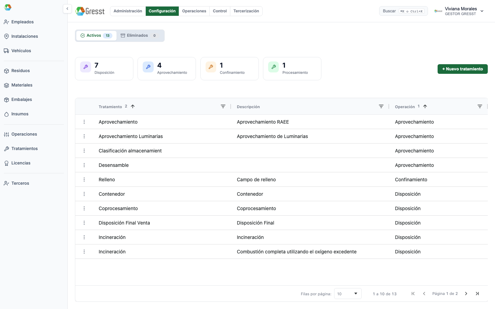
- **Instalaciones:** nombre, instalación padre, dirección, contactos, capacidades (recolectar, almacenar, disponer, entregar, recibir, tratar) y activo.

  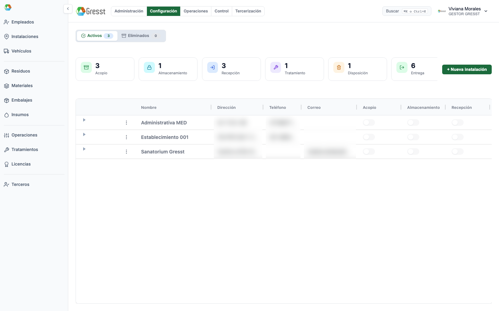
- **Vehículos:** la placa identifica al vehículo. Los datos técnicos los administra la cuenta propietaria verificada; cada cuenta administra su uso y su depósito. Ver [Vehículos](catalogos.md#vehículos).

  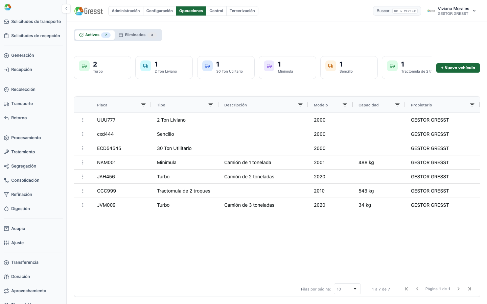
- **Terceros:** una ficha por empresa, sea cliente, proveedor o ambos. Cada tarjeta de la lista lleva una insignia (**Conectado**, **Invitación enviada**, **Por responder**, **Subcuenta**) que dice cómo estás relacionado con esa empresa; sus acciones están en la ficha, en **Resumen → Relación**. En la ficha de un tercero conectado, el nombre y la identificación vienen de su cuenta. Ver [Empresas e identidad](identidad.md) y [Trabajar conectados](guia_conexiones.md).

  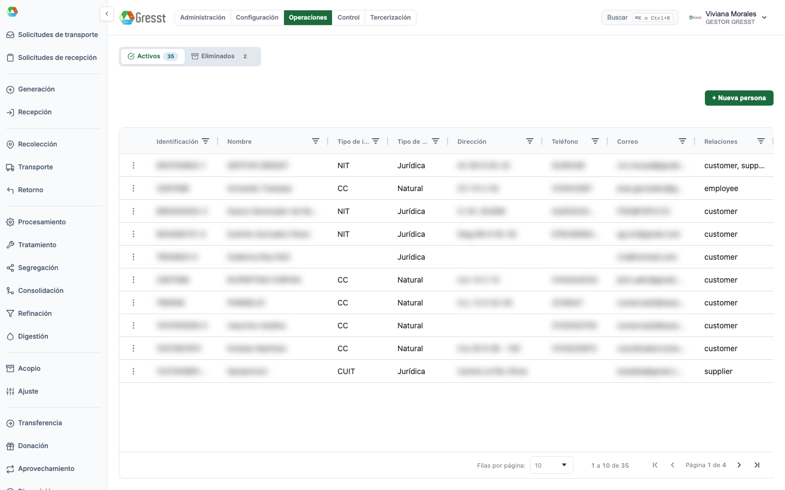
  - **Nueva subcuenta** (solo Administrador) crea la cuenta de un cliente que tú administras; **Convertir en subcuenta** (en la tarjeta **Relación** de su ficha) hace lo mismo con un tercero que ya tienes. En la lista, su tarjeta lleva la insignia **Subcuenta** y su ficha ofrece **Cuenta propia** en lugar de invitarla. Su ficha es de solo lectura; en **Resumen**, la tarjeta **Subcuenta** tiene los botones **Cuenta propia** y **Desactivar**. Ver [Subcuentas](guia_subcuentas.md).
- **Si tu cuenta es una subcuenta:** el menú se reduce a lo que usa una subcuenta, y **Residuos** es el catálogo de tu proveedor, en solo lectura, con el aviso *Tu catálogo lo administra [proveedor]*. Si trabajas con varios proveedores, al entrar eliges uno y lo cambias desde el menú de usuario; debajo del encabezado ves *Conectado a [proveedor]*. Ver [Subcuentas](guia_subcuentas.md#si-eres-la-subcuenta).

---

## Tercerización

Todo lo que contratas a tus proveedores:

- **Solicitudes a proveedores:** pedir un servicio con tus tipos y tus sedes, y **aprobar o rechazar** lo que tu proveedor registra a tu nombre.
- **Lo que mis proveedores tienen de mí:** en modo lectura, las sedes, residuos, materiales, vehículos y contactos que tu proveedor tiene registrados de tu empresa. Es lo que puedes adoptar como propio.
- **Certificados:** los que tus proveedores te publicaron, con filtro por tipo.

Detalle: [Trabajar conectados](guia_conexiones.md#si-contratas-servicios).

---

## Administración

Solo para el propietario de la cuenta: **Cuenta** (datos y licencias), **Propietario**, **Usuarios**, **Roles** (permisos de cada rol), **Parámetros**, **Módulos** (qué modos de solicitud tiene la cuenta) e **Integraciones** (correo, SIESA).

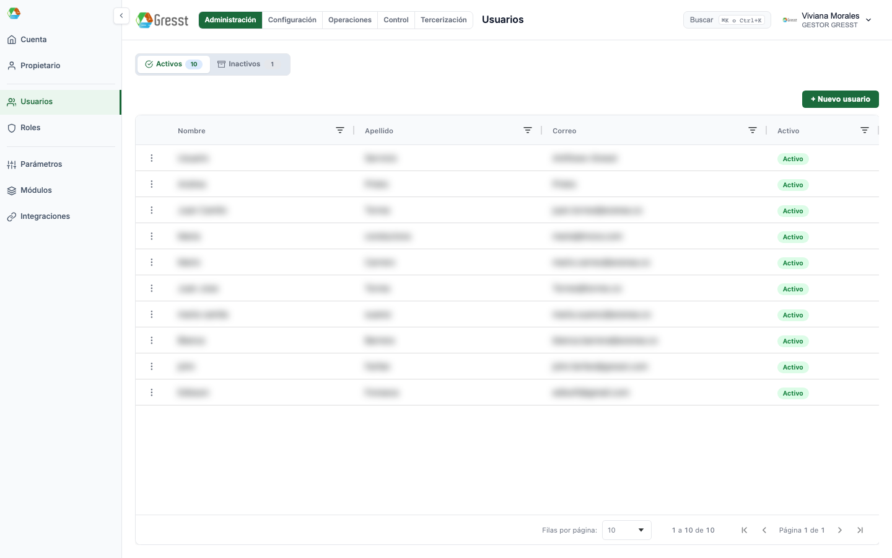

En **Roles** eliges un rol a la izquierda y ves su descripción, sus **Permisos** y los **Usuarios** que lo tienen. Puedes crear un rol nuevo o duplicar uno existente.

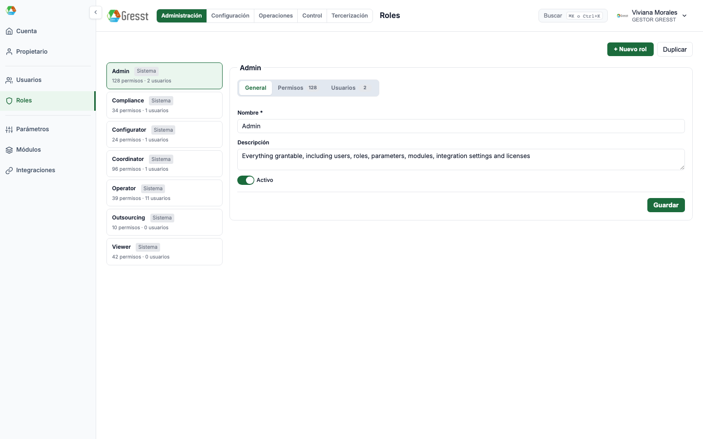

### Historial de cambios

En la ficha de un tercero o de una instalación, la pestaña **Historial** muestra quién cambió cada dato, cuándo y qué valor tenía antes. Lo ven el propietario, los administradores y los roles con **Auditoría → Ver**. Ver [Historial de cambios](auditoria.md).

### Usuarios inactivos y correos

Al desactivar a un usuario pierde el acceso, pero **su correo sigue reservado**: nadie más puede registrarse con esa dirección. Para reutilizarla:

1. En **Usuarios**, localiza al usuario **inactivo** (si está activo, desactívalo primero).
2. **⋮ → Liberar correo**, escribe el **motivo** (obligatorio, hasta 500 caracteres) y confirma.

Solo cambia su acceso: el nombre, la contraseña, los roles y el historial se conservan. Para que vuelva a entrar, edita al usuario y escribe un correo real. Si repites la acción sobre un correo ya liberado, no pasa nada.

- No puedes liberar el correo del **propietario**: transfiere antes la propiedad de la cuenta.
- Solo aplica a usuarios de tu cuenta.
- Si un correo está en un usuario inactivo o en una cuenta inactiva y su dueño lo **confirma** al registrarse (enlace mágico, Google o Microsoft), Gresst se lo asigna sin que nadie lo libere. Sin esa confirmación, el registro dice que el correo ya está en uso.
